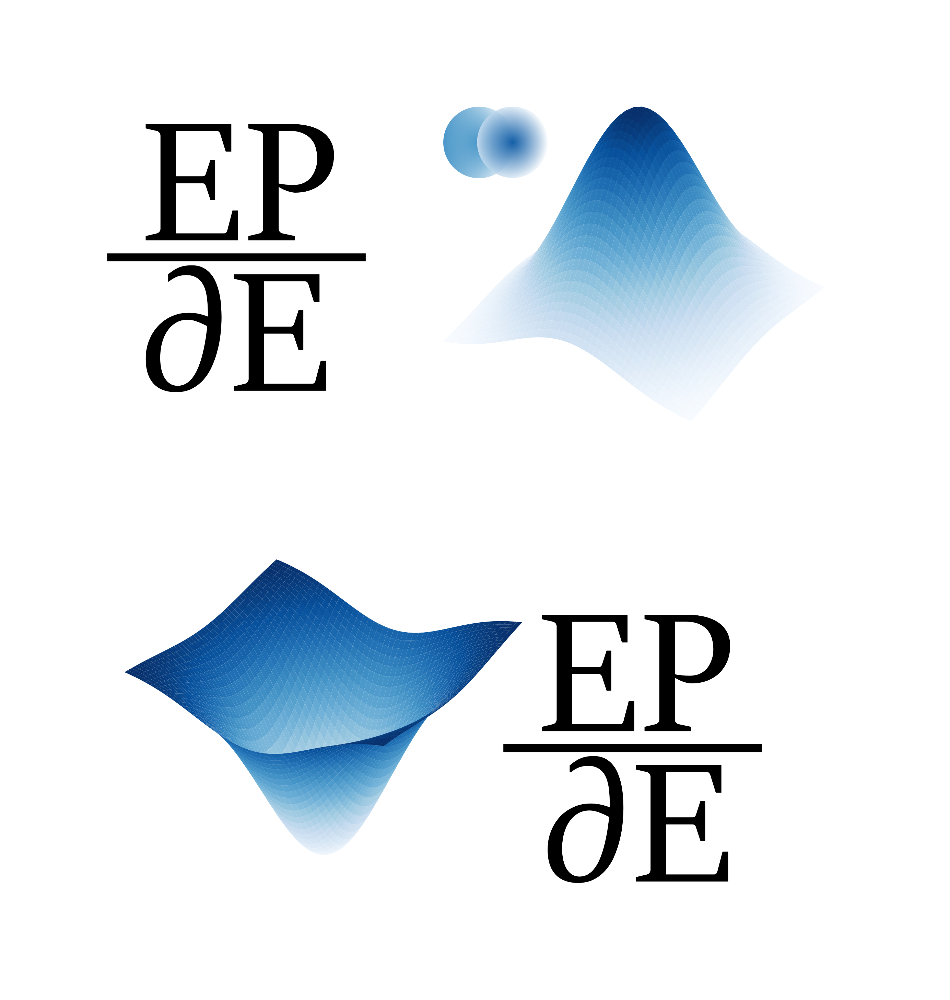

We use this repository as the main entry point for the EDPE framework.

We are of opinion that partial differential equations (PDE) discovery is more that the regression in the prescribed differential terms space. We propose the novel method of evolutionary equation discovery. Apart from the differential equations we have the algrbraic expressions discovery algorithm that is now uses same abstractions.

The project is maintained by the research team of the Natural Systems Simulation Lab, which is a part of the National Center for Cognitive Research of ITMO University.

The intro video about EPDE is available here:

.. image:: https://res.cloudinary.com/richarddedekind/image/upload/v1623953761/EDPE_front_dsyl9h.png
   :target: https://www.youtube.com/watch?v=BSXGCeuTcdc
   :alt: Introducing EPDE

EPDE features
==============

The main features of the framework are as follows:

- We dont need to create prescribed library of terms - our 'building blocks' are single differential terms or simple functions
- We have the multi-objective version that allows to obtain Pareto frontier of the equations, which helps the expert to choose one from several equation. 
- We use our own numerical differntiaion scheme, which allows to deal with high noise values
- We have solver to visualize the differential equations discovery process to add more control (https://github.com/ITMO-NSS-team/torch_DE_solver)

Installation
============

Common installation:

.. code-block::

  $ pip install epde

Examples & Tutorials
====================

Equation discovery
------------------

Supply coordinates in array-axis order. Each observed field has one dimension per
coordinate. Multiple trajectories can have different grids and lengths while
sharing axis names, variables, and a search configuration.

.. code-block:: python

   import numpy as np
   from epde import DiscoveryResult, EpdeSearch, TrajectoryData

   t = np.linspace(0, 12, 240)
   data = TrajectoryData({"t": t}, {"u": np.sin(t), "v": np.cos(t)})
   with EpdeSearch(default_preprocessor_type="FD") as search:
       result = search.discover(data)
   for system in result.front:
       print(system["objectives"], [eq["text"] for eq in system["equations"]])
   result.save("equations.json")
   equations = DiscoveryResult.load("equations.json")

Each result records the target factors, other terms and their fitted
coefficients, the intercept, token parameters, and measurement geometry.
Multiobjective results provide Pareto levels and per-variable fronts.
Single-objective results provide ranked candidates.

Set ``evaluation_form`` to choose how EPDE measures a candidate equation.
The default, ``strong``, evaluates fields and derivatives at individual grid
points. The ``weak`` form integrates over windows. The ``forward`` form fits
time increments using predictors at the start of each interval and requires
a solver-free plain search. The result's ``measurements`` list records the
form and row geometry for each trajectory and variable.

Observed forcing belongs in the sample. For example,
``external_inputs={"forcing": force_values}`` makes the measured array
available to the search on that trajectory. A matching stored-token family
can set whether the input may stand alone in a term. For forward fitting,
declare ``available_at_origin=True`` on that family when its value is known
at the beginning of each prediction interval.

A long-format CSV has one row per coordinate tuple and trajectory. Columns
can be in any order. List coordinates in the desired array-axis order.

.. code-block:: python

   from epde import read_trajectories_csv

   samples = read_trajectories_csv("fields.csv", coordinates=["t", "x"],
                                   fields={"u": "observed"}, trajectory_id="trial")

Use the same search settings and observations to resume a deterministic CPU run.
When using ANN preprocessing on a machine with a GPU, set
``preprocessor_kwargs={"device": "cpu"}`` to run its training on the CPU.
A checkpoint is a local Python pickle archive. Load it only from a trusted source.
Each completed epoch replaces the previous checkpoint. The optional total epoch
budget counts epochs from the beginning of the run.

.. code-block:: python

   with EpdeSearch(device="cpu") as search:
       result = search.discover(samples, checkpoint="run.zip")
   with EpdeSearch(device="cpu") as search:
       result = search.resume("run.zip", samples, total_epochs=200)

Citations
============

@article{maslyaev2021partial,
  title={Partial differential equations discovery with EPDE framework: application for real and synthetic data},
  author={Maslyaev, Mikhail and Hvatov, Alexander and Kalyuzhnaya, Anna V},
  journal={Journal of Computational Science},
  pages={101345},
  year={2021},
  publisher={Elsevier}
}

@article{maslyaev2019discovery,
  title={Discovery of the data-driven differential equation-based models of continuous metocean process},
  author={Maslyaev, Mikhail and Hvatov, Alexander},
  journal={Procedia Computer Science},
  volume={156},
  pages={367--376},
  year={2019},
  publisher={Elsevier}
}

