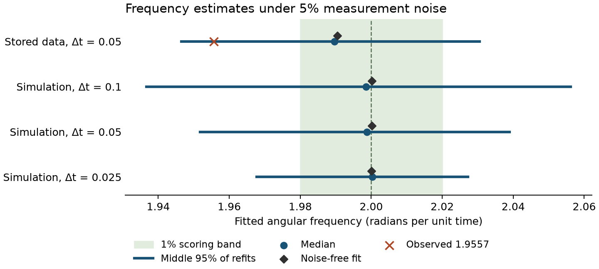

# How precisely is the trigonometric frequency identified?

The forced oscillator has registered angular frequency 2. Holding the equation terms fixed, EPDE fitted 1.9557 on the noisy record that missed the benchmark. The central 95% of 250 independent noise refits on the same underlying observations ran from **1.9465 to 2.0305**. The observed miss falls within the variation generated by the benchmark's measurement model. Only **148/250** estimates fell inside the benchmark's 1% band of 1.98–2.02. This is a sampling distribution conditional on the recorded signal and selected equation. [Numerical results](frequency_error.csv)

| Observations | Sample spacing | Frequency without added noise | Middle 95% with 5% noise | Refits in the 1% band |
|---|---:|---:|---:|---:|
| Stored benchmark | 0.05 | 1.99047 | 1.9465–2.0305 | 148/250 |
| Converged simulation | 0.10 | 2.00022 | 1.9367–2.0562 | 105/250 |
| Converged simulation | 0.05 | 2.00013 | 1.9518–2.0390 | 146/250 |
| Converged simulation | 0.025 | 2.00007 | 1.9677–2.0272 | 205/250 |

The first row uses an actual discovered parent from the failed screen seed. Its pivot, predictors, intercept choice, frequency bounds and training windows are held fixed. Each fit re-estimates all linear coefficients at each candidate frequency. Raw observations receive independent Gaussian measurement errors with standard deviation 5% of the benchmark variable's standard deviation. Rebuilding the weak columns from the perturbed observations preserves the dependence between overlapping weak windows. Replaying the original seed reproduced 1.9557. [Refit code](frequency_error.py) · [All draws](frequency_error_draws.csv)

The token library's initial peak for this parent was 2.0540. Refinement allowed a continuous frequency between 1.6613 and 2.4467, half a training Fourier bin on either side of the peak. The optimizer tolerance controls numerical precision within this interval. The noise refits measure how far the fitted value moves when the observations change. [Stored parent and child](forcing_profiles.csv)

The mesh study integrates the registered oscillator from the specified state (0.8, 2) with convergence checked at two solver tolerances. Each mesh samples the same simulated trajectory on [0, 8], with the same 65 weak-window centres, physical half-width 0.8, stride 0.1 and per-observation noise variance. Coarser meshes take a subset of the fine-grid samples and their noise draws. Across a fourfold change in spacing, the clean fitted frequency moved by about 0.00015. Under independent measurement noise, denser sampling also supplied more observations per physical window and narrowed the fitted-frequency distribution. The stored trajectory's clean-fit offset has several possible sources. The mesh study isolates the spacing effect on its own simulated trajectory. [Mesh and noise results](frequency_error.csv)

## How to report a discovered frequency

Report the fitted value alongside the structural pattern, its sensitivity to measurement noise and sampling, and the frozen equation's held-out residual. Keep the prespecified 1% hit as a benchmark endpoint. When data have uncertain timestamps, propagate that uncertainty through the trigonometric arguments as well. With an unknown physical system, estimate the observation-error model from instrument calibration or replicate measurements. With correlated observations, simulate or resample their dependence. A confidence interval for an unknown frequency needs a calibrated model or validated coverage. The empirical ranges above describe repeated measurements conditional on the chosen equation. [Weak-form discretization and noise](https://pmc.ncbi.nlm.nih.gov/articles/PMC10795802/) · [Parameter profiles and practical identifiability](https://doi.org/10.1093/bioinformatics/btp358)
