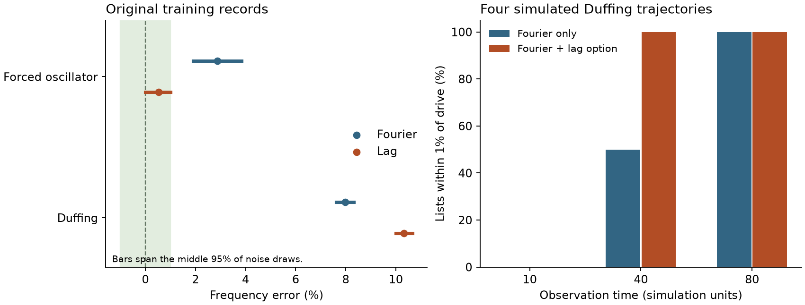

# Estimating token frequencies from displacement alone

The signal-only alternative put the registered frequency on the forced oscillator's two-candidate list in **244/250** fresh 5% noise draws. The native two-peak list scored **0/250**. On the short Duffing record both scored **0/250**. The extractor uses the training displacement and its sample spacing. It performs zero equation-term or coefficient fits. The benchmark counts a hit when either candidate lies within 1% of the known drive. [Paired results](by_record.csv) · [Frozen protocol](protocol.md)

| Original training record | Observed driving cycles | Strongest Fourier peak, median | Repeat-period candidate, median | Native hits | New hits |
|---|---:|---:|---:|---:|---:|
| Forced oscillator, drive 2 | 2.55 | 2.0573 | 2.0105 | 0/250 | 244/250 |
| Duffing, drive 1 | 1.59 | 1.0797 | 1.1032 | 0/250 | 0/250 |

EPDE retains its strongest Fourier peak. When the other peak has weak spectral support, the experimental rule asks how far the signal can be shifted before its shape repeats. It looks near the first peak's period, centres and scales the overlapping segments, and accepts a clear correlation maximum. That lag supplies a second candidate, with angular frequency equal to 2π divided by the lag in time units. A strong second Fourier peak keeps its slot. Each original dataset produced the lag candidate in every noise draw. The central 95% of lag estimates was 2.0000–2.0199 for the forced oscillator and 1.1001–1.1067 for Duffing. These ranges describe repeated measurements of the same underlying trace. [Extractor](signal_frequency.py) · [All proposals](paired_frequencies.csv)



## Observation time and transfer

Four independent Duffing simulations used the original initial state, two other initial states, and a drive shifted to 1.2. Each trajectory had 50 paired noise draws. At 10 time units, both methods scored 0/200. At 40 units, the native list scored 100/200 and the alternative scored 200/200. At 80 units, both scored 200/200. The 40-unit gain came from the velocity start and the shifted drive. The longer acquisitions include more cycles and allow the transient to settle. Sample spacing, absolute noise level and noise values at shared times were fixed within each trajectory. [Results by trajectory and duration](by_record.csv)

The forced oscillator's frequency estimate also depended on the initial state. At the original record length and drive 2, both methods scored 50/50 on the displacement start and 0/50 on the velocity start. With its drive shifted to 2.4, both scored 0/50 at each of the three durations. Even at the longest duration, the alternative list's nearest frequency had a median of about 1.98. A repeatable period of the response can differ from the coefficient frequency that generated it. The study measured proposal accuracy. Complete-equation discovery is a separate endpoint. [All transfer results](by_record.csv)

## Use and reproduction

From this research directory, pass a finite uniformly sampled training signal and the spacing in its time units. Frequencies are angular and can be handed directly to EPDE's explicit token grid when the returned tuple is nonempty.

```python
from signal_frequency import propose
from epde.interface.prepared_tokens import TrigonometricTokens

fourier_peaks, candidates, used_lag = propose(u_train, dt)
if candidates:
    trig_tokens = TrigonometricTokens(freq_values=sorted(candidates), dimensionality=0)
```

Run `python benchmark.py` in the EPDE research environment. It compares native estimates against 24 archived runs, checks known single- and two-tone signals, checks constant input and verifies simulation convergence at two integrator tolerances. The benchmark's stored-record noise convention is 5% of the original signal's standard deviation. Each simulated trajectory uses 5% of its first training prefix's standard deviation. The estimator is a research option for scalar time series. The lag calculation is related to autocorrelation-based pitch estimators and uses the specific window and acceptance rules in the protocol. [Benchmark](benchmark.py) · [De Cheveigné and Kawahara, 2002](https://doi.org/10.1121/1.1458024)
