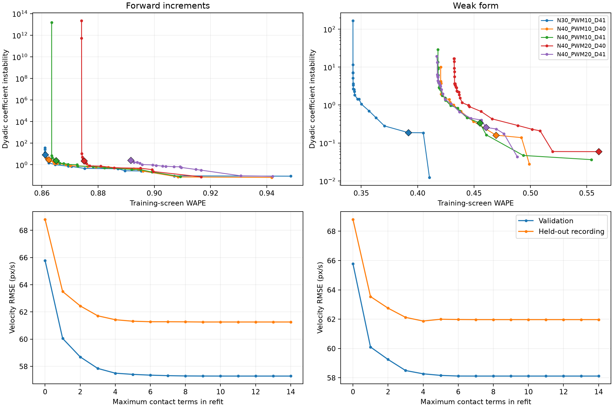

# Pareto fronts for the robot collision law

The search covers all 14 original contact terms, every subset of those terms, and both native intercept choices. The target is the contact contribution to the 0.4 s velocity after subtracting the frozen self-motion and wall model. All test errors use observed forward velocities on the omitted recording, including for weak-form equations.

The across-recording fronts average the two training-screen objectives for each common term set over all five folds, retain structures eligible in all five and recompute nondominance. Each recording has equal weight. The tables give mean and per-recording held-out R², recording-balanced RMSE in px/s and a separate equation refitted on all five recordings. The cross-validation scores use the original fold-specific coefficients. [Merged forward front](merged_strong.csv), [merged weak front](merged_weak.csv) and [merged front plot](merged_fronts.png).

For transfer, the common-structure table gives exact front membership in all five folds and the shared terms of the five validation winners. It also gives the no-contact baseline and each recording’s held-out errors for the fixed structures. Native fits use the training screen. Physical refits use all training rows with zero intercept. [Common structures and worst-recording scores](common_structures.csv).

Each upper curve is one recording held out. Both axes are minimized. Diamonds mark the equation on each native front with lowest internal validation RMSE. Each lower curve uses the lowest-validation-error full-training refit within each term budget. The lower panels weight each recording equally.

## Equations on the expanded native front selected by validation

| Held-out recording | Form | Contact terms (plus any intercept) | Screen WAPE | Instability | Validation RMSE | Test RMSE | Test R² | Test pair-normal RMSE |
|---|---|---|---:|---:|---:|---:|---:|---:|
| N30_PWM10_D41 | strong | overlap+front+neighbor_front+approach+gear+drive+drive_in+band3+band4+intercept | 0.8612 | 8.611 | 56.53 | 53.73 | 0.617 | 59.28 |
| N40_PWM10_D40 | strong | overlap+front+neighbor_front+approach+drive+drive_in+intercept | 0.8625 | 2.898 | 57.79 | 58.31 | 0.059 | 72.51 |
| N40_PWM10_D41 | strong | overlap+front+neighbor_front+approach+drive+drive_in | 0.8650 | 2.496 | 58.26 | 58.70 | 0.283 | 71.27 |
| N40_PWM20_D40 | strong | overlap+front+neighbor_front+approach+drive_in+intercept | 0.8751 | 2.266 | 57.61 | 64.93 | 0.188 | 74.13 |
| N40_PWM20_D41 | strong | overlap+front+neighbor_front+approach+drive+drive_in | 0.8916 | 2.525 | 56.97 | 69.85 | 0.233 | 71.86 |
| N30_PWM10_D41 | weak | push+approach | 0.3918 | 0.1878 | 59.77 | 55.59 | 0.590 | 68.26 |
| N40_PWM10_D40 | weak | push+approach | 0.4695 | 0.1611 | 60.73 | 62.08 | -0.067 | 90.61 |
| N40_PWM10_D41 | weak | push+front+approach | 0.4552 | 0.3359 | 60.63 | 61.11 | 0.223 | 83.47 |
| N40_PWM20_D40 | weak | overlap | 0.5605 | 0.05918 | 60.16 | 66.67 | 0.144 | 81.67 |
| N40_PWM20_D41 | weak | push+approach | 0.4606 | 0.2577 | 59.62 | 71.20 | 0.203 | 79.20 |

RMSE is in camera px/s (divide by 45.08199 for cm/s). Pair-normal RMSE measures the error in the two robots’ relative velocity along the line joining their centers for pairs within 253 px at prediction time. Held-out R² uses the two Cartesian components. Predictions use the frozen equation before hard-disk position projection.

## Error by term budget

| Term budget | Most frequent forward structure | Folds selecting it | Forward test RMSE | Forward pair-normal RMSE | Weak test RMSE | Weak pair-normal RMSE |
|---:|---|---:|---:|---:|---:|---:|
| 0 | (none) | 5/5 | 68.81 | 91.70 | 68.81 | 91.70 |
| 1 | overlap | 5/5 | 63.50 | 81.60 | 63.54 | 81.29 |
| 2 | overlap+drive_in | 5/5 | 62.45 | 71.81 | 62.75 | 76.85 |
| 3 | overlap+front+drive_in | 5/5 | 61.72 | 68.73 | 62.12 | 73.66 |
| 4 | overlap+front+approach+drive_in | 5/5 | 61.43 | 68.29 | 61.87 | 73.22 |
| 6 | overlap+front+neighbor_front+approach+drive+drive_in | 4/5 | 61.28 | 68.57 | 61.98 | 73.86 |
| 8 | overlap+front+neighbor_front+approach+slide+gear+drive+drive_in | 3/5 | 61.27 | 68.38 | 61.97 | 73.84 |
| 10 | overlap+front+neighbor_front+approach+slide+gear+drive+drive_in+band0+band4 | 3/5 | 61.26 | 68.42 | 61.97 | 73.84 |
| 14 | overlap+front+neighbor_front+approach+slide+gear+drive+drive_in+band0+band1+band3 | 2/5 | 61.26 | 68.42 | 61.97 | 73.84 |

## Terms, coverage and scoring

The 14 terms are `push` (radial push), `overlap` (distance-weighted radial response), `front` and `neighbor_front` (headings toward the other robot), `approach` (closing speed), `slide` (tangential relative velocity), `gear` (tangential response to summed spin), `drive` (neighbor propulsion), `drive_in` (its inward component), and `band0` through `band4` (radial push in disjoint center-distance intervals). The band edges in units of 230 px are 0, 0.93, 0.97, 1.00, 1.05 and 1.10. All terms are additive vector columns with power one. The scalar native intercept adds the same constant to each Cartesian component.

The original 30 NSGA-II runs allowed six right-hand-side terms. We retain every returned member and replay both recorded objectives, preserving each seed and its coefficients. The expanded search exhaustively applies EPDE’s weighted least-squares subset fitter and dyadic instability scorer to the same 2,048 training-screen rows per fold and form. The term budget is wide enough for all 14 terms, the optional intercept and the target. EPDE sizes the dyadic partitions from that budget, so compare instability values within each search setting. WAPE is the sum of absolute residuals divided by the sum of absolute target values. Dyadic instability measures how much fitted coefficients vary across dyadic partitions of those screen rows.

There are 16,384 physical subsets and 32,768 variants including the intercept choice per fold and form. The empty and intercept-only variants serve as controls. Because `push = band0 + band1 + band2 + band3 + band4`, coefficients are non-unique whenever all six appear. The candidate table reports their prediction errors from the equivalent representation with `push` removed. Those duplicate representations are excluded from front selection. Native eligibility also applies EPDE’s amplification guard and requires a finite dyadic score below its overflow sentinel. A blank dyadic score denotes an ineligible equation. Every variant retains its prediction error.

The physical refit uses all training rows, recording-balanced least squares and zero intercept to preserve the vector law under rotation. Each fold fits on the first 75% of four recordings, uses their remaining quarters for validation and evaluates the frozen equation on the fifth recording. Physical refit fronts minimize term count and validation RMSE. Held-out errors are displayed only after front construction. A recording can share individual robot IDs with the training recordings.

## Data files

- [Expanded native Pareto front](native_pareto.csv) contains 198 equations with coefficients, both objectives and held-out errors.
- [Original NSGA-II fronts](nsga2_fronts.csv) contains all 306 returned entries across seeds, including repeated equations.
- [Full-training validation Pareto front](validation_pareto.csv) contains 95 equations with coefficients and held-out errors.
- [Each of the 14 terms fitted alone](single_terms.csv) gives both formulations, all five test recordings, coefficients and errors.
- [Every candidate and its errors](all_candidates.csv.gz) includes the original support, its representative, eligibility and front flags, coefficients and errors. Native screen fits use the unprefixed columns. The `refit_` columns give full-training physical fits for the no-intercept variant. The `equation` column contains the additive contact contribution.
- [All 15 term budgets](term_budgets.csv) gives recording-balanced errors. Selected sizes follow the alphabetical order of held-out recording names.

Run `python projects/robot/collision/run.py --stage pareto` from the repository root to reproduce the tables and figure.
