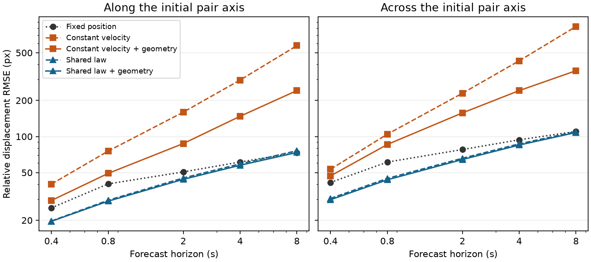

# Free rollouts of the shared collision law

Five leave-one-recording-out coefficient fits, 40 nonoverlapping starting times in each recording, and up to eight seconds of autonomous evolution per start. The shared vector and normal equation structures were previously selected using the five recordings. This is a retrospective transfer test. Coefficients, propulsion and arena calibration for each held-out recording come from the other four.

The constrained shared law improves both pair directions against fixed position through four seconds. At eight seconds the normal displacement errors are effectively tied. Some tangential advantage persists. The geometry-only constant-velocity control has substantially larger errors.

## Errors along and across the line joining the robots

At each starting time, keep every pair initially within 253 px and freeze its observed normal and tangent. Endpoints use the measured relative displacement over the entire horizon. Positive normal displacement means separation along the initial axis. RMSE is in camera px (one robot diameter = 219.55 px). Entries are means of five recording-level RMSEs.

| Horizon (s) | Model | Pair-normal RMSE | Pair-tangent RMSE | Robot position RMSE | Normal R² | Tangent R² |
|---:|---|---:|---:|---:|---:|---:|
| 0.4 | Fixed position | 25.39 | 41.39 | 41.41 | -0.119 | -0.001 |
| 0.4 | Constant velocity | 40.10 | 53.35 | 54.33 | -1.777 | -0.677 |
| 0.4 | Constant velocity + geometry | 29.26 | 46.95 | 47.42 | -0.489 | -0.295 |
| 0.4 | Shared law | 19.74 | 30.46 | 30.07 | 0.319 | 0.453 |
| 0.4 | Shared law + geometry | 19.62 | 29.72 | 29.45 | 0.328 | 0.482 |
| 0.8 | Fixed position | 40.26 | 61.18 | 62.45 | -0.156 | -0.000 |
| 0.8 | Constant velocity | 75.67 | 104.57 | 108.82 | -3.189 | -2.016 |
| 0.8 | Constant velocity + geometry | 49.29 | 85.85 | 88.44 | -0.753 | -1.014 |
| 0.8 | Shared law | 29.41 | 44.73 | 44.56 | 0.363 | 0.455 |
| 0.8 | Shared law + geometry | 28.90 | 43.54 | 43.58 | 0.387 | 0.485 |
| 2 | Fixed position | 50.67 | 77.90 | 77.35 | -0.120 | -0.001 |
| 2 | Constant velocity | 159.76 | 229.59 | 236.38 | -10.984 | -8.139 |
| 2 | Constant velocity + geometry | 87.40 | 157.47 | 160.32 | -2.471 | -3.238 |
| 2 | Shared law | 45.10 | 65.88 | 65.44 | 0.100 | 0.275 |
| 2 | Shared law + geometry | 43.93 | 64.30 | 64.06 | 0.147 | 0.309 |
| 4 | Fixed position | 61.29 | 93.89 | 92.05 | -0.091 | -0.001 |
| 4 | Constant velocity | 296.00 | 428.50 | 441.93 | -27.165 | -21.112 |
| 4 | Constant velocity + geometry | 147.59 | 241.63 | 248.68 | -5.832 | -5.926 |
| 4 | Shared law | 59.16 | 86.90 | 85.42 | -0.029 | 0.139 |
| 4 | Shared law + geometry | 57.58 | 84.94 | 83.53 | 0.031 | 0.179 |
| 8 | Fixed position | 73.53 | 110.31 | 107.37 | -0.051 | -0.001 |
| 8 | Constant velocity | 573.45 | 827.84 | 855.85 | -71.205 | -59.051 |
| 8 | Constant velocity + geometry | 241.81 | 354.23 | 368.41 | -11.469 | -9.890 |
| 8 | Shared law | 76.17 | 109.83 | 107.02 | -0.148 | 0.003 |
| 8 | Shared law + geometry | 73.62 | 108.05 | 104.76 | -0.054 | 0.040 |

Robot position RMSE uses Euclidean displacement error per robot. Pair R² uses observed displacement variance within a recording, then weights recordings equally. Dividing displacement RMSE by its horizon converts it to interval-average velocity RMSE in px/s.

## Incoming motion

Classify pairs with their measured relative velocity over the 0.4 s before the origin. Displacements remain signed along the initial axes even if a pair turns or later separates.

| Horizon (s) | Initial state | Eligible pairs | Fixed normal RMSE | Constant normal RMSE | Shared normal RMSE | Shared + geometry normal RMSE |
|---:|---|---:|---:|---:|---:|---:|
| 0.4 | Approaching | 4,870 | 24.92 | 47.82 | 19.39 | 19.28 |
| 0.4 | Separating or stationary | 3,768 | 25.70 | 26.64 | 20.11 | 19.97 |
| 2 | Approaching | 4,870 | 53.02 | 199.47 | 45.97 | 44.75 |
| 2 | Separating or stationary | 3,768 | 47.13 | 82.84 | 43.82 | 42.70 |
| 8 | Approaching | 4,870 | 74.75 | 715.90 | 76.45 | 73.42 |
| 8 | Separating or stationary | 3,768 | 71.58 | 298.05 | 75.54 | 73.59 |

## Physical and numerical failures

Each count is a whole-swarm rollout out of 200. A wall crossing occurs when a center transitions from inside to more than 1 px beyond the fold-calibrated center envelope. A new overlap occurs when two centers cross below diameter minus 1 px. Count each rollout once per category by the given horizon. The observed tracks supply the reference because the fitted envelope and tracker both have error. Per-start files also count affected robots and pairs. Numerical failure means a nonfinite state or an unresolved projection. Errors use completed predictions and the CSVs give eligible and scored pair counts.

| Horizon (s) | Model | New wall crossing | New overlap | Numerical failure |
|---:|---|---:|---:|---:|
| 0.4 | Fixed position | 0 | 0 | 0 |
| 0.4 | Constant velocity | 168 | 200 | 0 |
| 0.4 | Constant velocity + geometry | 0 | 0 | 0 |
| 0.4 | Shared law | 130 | 157 | 0 |
| 0.4 | Shared law + geometry | 0 | 0 | 0 |
| 0.4 | Observed tracks | 101 | 182 | 0 |
| 2 | Fixed position | 0 | 0 | 0 |
| 2 | Constant velocity | 200 | 200 | 0 |
| 2 | Constant velocity + geometry | 0 | 0 | 0 |
| 2 | Shared law | 168 | 200 | 0 |
| 2 | Shared law + geometry | 0 | 0 | 0 |
| 2 | Observed tracks | 117 | 200 | 0 |
| 8 | Fixed position | 0 | 0 | 0 |
| 8 | Constant velocity | 200 | 200 | 0 |
| 8 | Constant velocity + geometry | 0 | 0 | 0 |
| 8 | Shared law | 182 | 200 | 0 |
| 8 | Shared law + geometry | 0 | 0 | 0 |
| 8 | Observed tracks | 125 | 200 | 0 |

## Implementation and checks

Starts are at frames 100, 300 and every 200 frames thereafter while eight seconds of outcomes remain. The first 20 frames of each pose history end at the starting frame. The full prior contact history is resolved at each origin. Fixed position holds the observed centers. Constant velocity extrapolates the last 0.4 s of raw center motion. The shared law uses the archived joint update that assigns one velocity to each robot across simultaneous contacts. It recalculates velocities and neighbors every 0.4 s. Between updates it advances centers at 25 Hz. Every subsequent heading advances at that robot’s signed angular rate measured in the 0.4 s before the origin. There is no noise injection or use of later observed poses.

All physical diagnostics inspect the path at 25 Hz. The free law uses frame-local disk-projected positions for its kinematic inputs and leaves predicted raw centers unconstrained. The geometry variants project centers into the fitted arena and separate overlapping disks after each 0.04 s advance. The constant-velocity geometry control applies the same correction. Final forecast outputs use raw observed positions as their reference.

The first model velocity, before geometric correction, is checked at every selected close-pair origin against the archived held-out coherent forecasts. Paired uncertainty intervals resample adjacent 16-second blocks within each recording 2,000 times and keep the five recording weights equal. Their scope is variation within these recordings.

[Errors by recording](pair_errors_by_recording.csv) · [Failures by recording](stability_by_recording.csv) · [Paired RMSE differences and intervals](paired_differences.csv) · [First-step verification](archive_checks.csv)
