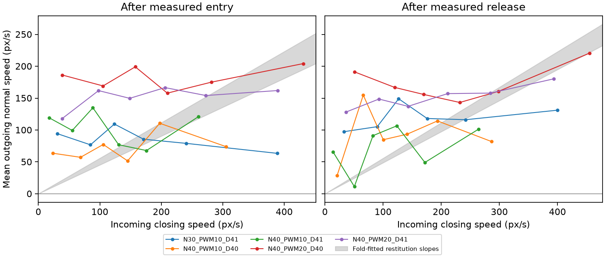

# Event-level EPDE test of normal restitution

Tested hypothesis: positive incoming closing speed c = −u⁻ predicts outgoing signed speed as u⁺ = ec with zero intercept. The fitted coefficient measures finite camera windows. Robot mass is unnecessary for this velocity-ratio test.

## Main held-out results

Two positions per slope span 40 ms at 25 Hz. Each fold fits coefficients on the first 75% of the other four recordings, with equal weight per recording. The last 25% of those four recordings choose among eligible native EPDE proposals. Test RMSE and R² are first computed within recording and then averaged equally. Speeds and errors are in px/s.

| Outgoing window | Model | Events | RMSE | Mean R² |
|---|---|---:|---:|---:|
| After measured entry | Intercept + closing speed | 1,888 | 166.27 | -0.094 |
| After measured entry | Training mean | 1,888 | 166.54 | -0.097 |
| After measured entry | Validation-selected native EPDE | 1,888 | 169.56 | -0.141 |
| After measured entry | Continue incoming motion | 1,888 | 345.93 | -3.705 |
| After measured entry | Pure restitution | 1,888 | 174.48 | -0.206 |
| After measured entry | Zero speed | 1,888 | 199.83 | -0.576 |
| After measured release | Intercept + closing speed | 907 | 154.98 | -0.069 |
| After measured release | Training mean | 907 | 157.05 | -0.098 |
| After measured release | Validation-selected native EPDE | 907 | 154.16 | -0.057 |
| After measured release | Continue incoming motion | 907 | 349.86 | -4.514 |
| After measured release | Pure restitution | 907 | 161.05 | -0.153 |
| After measured release | Zero speed | 907 | 193.92 | -0.669 |

For the entry-based measurement, pure restitution adds 7.94 px/s of mean held-out RMSE relative to the training mean (paired 95% interval 4.33 to 11.54). The recordings show frequent separation, but a shared instantaneous physical restitution coefficient remains unverified.

## Learned coefficients and observed reversals

Both incoming and outgoing velocities are projected onto the same measured line of centers at entry. The pure model estimates e through the origin on training data. A negative estimate would be clipped to zero for the restitution prediction.

| Held-out recording | Entry events | Outgoing > 0 | Training e | Restitution R² | After-release events | Training e (release) |
|---|---:|---:|---:|---:|---:|---:|
| N30_PWM10_D41 | 539 | 74.6% | 0.558 | -0.240 | 312 | 0.549 |
| N40_PWM10_D40 | 196 | 67.9% | 0.538 | -0.081 | 109 | 0.539 |
| N40_PWM10_D41 | 200 | 78.5% | 0.498 | -0.223 | 92 | 0.557 |
| N40_PWM20_D40 | 444 | 84.5% | 0.453 | -0.306 | 180 | 0.487 |
| N40_PWM20_D41 | 509 | 83.1% | 0.472 | -0.178 | 214 | 0.520 |

Each point below averages one sixth of a recording’s held-out events, ordered by incoming speed. Shading spans the five zero-intercept slopes estimated on training recordings.

## Was the one-term law on the front?

Each balanced training screen contains the same number of distinct, time-ordered events per training recording. The native NSGA-II search used seed 923701, 12 epochs, up to four additive terms and one factor per term. EPDE removed the constant-valued bias token in its native search. A second enumeration used EPDE’s WAPE and dyadic coefficient-instability objectives on all 56 nonempty subsets of up to four of the six terms, explicitly including bias. The other terms are closing speed, its square divided by 100, absolute tangential speed, relative heading along the normal, and the magnitude of summed angular velocity times robot radius. All features precede entry except the axis used for projection. One response row represents one event, with no differentiation between rows.

| Outgoing window | Native evaluated (of 5) | Native final front (of 5) | Merged exhaustive front |
|---|---:|---:|---|
| After measured entry | 5 | 5 | Yes |
| After measured release | 5 | 4 | Yes |

The merged front minimizes mean training-screen WAPE and mean dyadic instability among structures eligible in all five folds. Test R² does not determine front membership. The constant baseline predicts the training mean without access to incoming speed. Paired intervals for held-out RMSE differences use 2,000 within-recording ten-second block resamples, conditional on the trained models.

## Isolation and timing sensitivity

An entry is the first observed crossing below the calibrated 219.55 px diameter after clearing 1.03 diameters. All incoming slope samples must be outside the chosen entry threshold. Both robots must be free of tracking flags and wall proximity throughout the measurement window. Strict isolation excludes any third robot within 253 px of either member. The looser analysis excludes third centers within 1.03 diameters (226.14 px). The main entry analysis keeps inward and outward outcomes, including events without a subsequent observed release. Release-based outcomes require clearance within one second and are conditional on that event.

| Isolation | Outgoing window | Slope duration | Eligible events, nominal diameter | Recordings with events | Range of trained e across scorable folds |
|---|---|---:|---:|---:|---|
| loose | After measured entry | 40 ms | 1,888 | 5 | 0.453 to 0.558 |
| loose | After measured entry | 80 ms | 1,115 | 5 | 0.457 to 0.586 |
| loose | After measured entry | 160 ms | 455 | 5 | 0.323 to 0.414 |
| loose | After measured release | 40 ms | 907 | 5 | 0.487 to 0.557 |
| loose | After measured release | 80 ms | 584 | 5 | 0.423 to 0.459 |
| loose | After measured release | 160 ms | 247 | 5 | 0.135 to 0.286 |
| strict | After measured entry | 40 ms | 74 | 4 | 0.031 to 0.364 |
| strict | After measured entry | 80 ms | 56 | 3 | 0.276 to 1.006 |
| strict | After measured entry | 160 ms | 38 | 1 | — |
| strict | After measured release | 40 ms | 43 | 1 | — |
| strict | After measured release | 80 ms | 36 | 1 | — |
| strict | After measured release | 160 ms | 26 | 1 | — |

The entry slope ends at the frame before the crossing. The first outgoing slope starts at the first frame inside the threshold, omitting the crossing interval from both velocity estimates. For release it starts at the first frame at or beyond 1.03 diameters. The contact timestamp is inferred from noisy center distances. Physical impact can occur between samples. Event-level conclusions concern the observed speed response at this resolution.

[All threshold and timing sensitivities](scores.csv) · [Eligibility and reversals](coverage.csv) · [Per-fold equations](equations_by_fold.csv) · [Merged fronts](equations_merged.csv) · [Timing on matched events](matched_timing.csv) · [Paired uncertainty](paired_uncertainty.csv)
