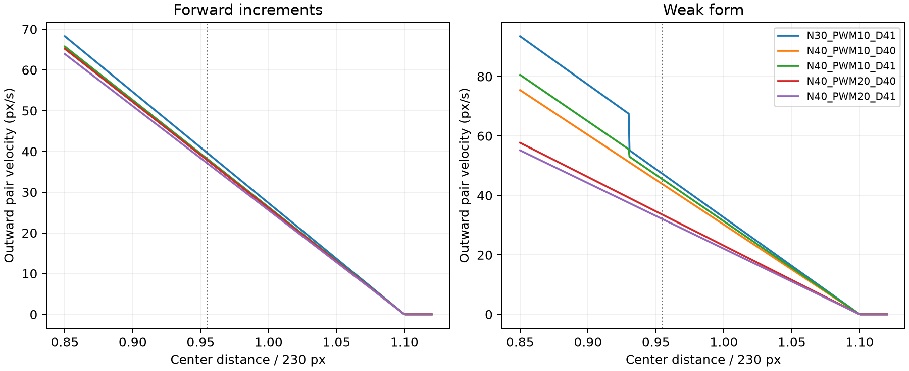
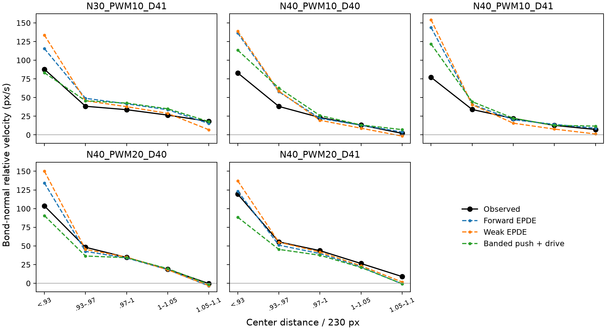

# Robot–robot collision laws across five recordings

Five leave-one-recording-out tests cover 30–40 robots, PWM 10–20, and 40–41 cm arenas. Each recording contains 8,250 frames at 25 Hz. Physical robot IDs can recur across recordings. Performance here measures transfer to a new setup with that overlap.

## The transferable contact term

The common structure with the lowest mean internal validation squared error yielded the following all-record coefficient estimate. The five held-out tests below assess the entire selection procedure. The all-record estimate uses those measurements for fitting.

**Pair contribution in px/s**  `0.111 approach +0.038 drive +0.236 drive_in +10.8 front +4.06 neighbor_front +264 overlap`  (Forward EPDE).

At a center separation of one physical cap diameter, the distance term alone contributes 38.3 px/s (0.85 cm/s) outward per neighbor. The closing speed, headings and neighbor propulsion determine the remaining contribution.

Add the contributions of neighbors within 253 px to the robot’s heading-dependent propulsion, previous velocity and inward wall response. The two propulsion coefficients are specific to robot ID and PWM. Unseen IDs use the training PWM average. The full model includes these coefficients and arena geometry. [Pooled law](pooled_law.json)

The outward unit vector points from neighbor to robot. `front` and `neighbor_front` weight it by the respective heading toward the other robot. `overlap` weights it by (253 − distance)/230. `band0…4` select intervals with edges 0, 0.93, 0.97, 1, 1.05 and 1.1 in units of 230 px. These coefficients and `push` have units of px/s. `approach` weights the outward direction by the positive closing speed. `slide` uses signed relative tangential velocity. `drive` sums neighboring propulsion and `drive_in` sums its positive inward projection. Their coefficients are dimensionless. `gear` weights the tangent by the robots’ summed angular velocities and has a coefficient in px/rad.

## Held-out drift

| Omitted recording | Forward R² | Weak R² | Banded baseline R² | Validation choice | Choice R² | Normal / tangent MAE, px/s |
|---|---:|---:|---:|---|---:|---:|
| N30_PWM10_D41 | 0.620 | 0.612 | 0.612 | Forward EPDE | 0.620 | 45.7 / 55.8 |
| N40_PWM10_D40 | 0.051 | 0.030 | -0.040 | Forward EPDE | 0.051 | 55.7 / 63.6 |
| N40_PWM10_D41 | 0.276 | 0.264 | 0.237 | Forward EPDE | 0.276 | 54.4 / 66.8 |
| N40_PWM20_D40 | 0.199 | 0.177 | 0.176 | Forward EPDE | 0.199 | 55.9 / 72.6 |
| N40_PWM20_D41 | 0.238 | 0.220 | 0.234 | Forward EPDE | 0.238 | 55.2 / 79.2 |

Forward EPDE increased held-out R² over banded push plus drive in 5/5 recordings. The paired changes ranged from +0.0042 to +0.0908.

Weak EPDE increased held-out R² over banded push plus drive in 4/5 recordings. The paired changes ranged from -0.0142 to +0.0698.

R² uses both Cartesian velocity components. The MAEs use touching pairs’ relative velocity in the frame of their bond. The full table includes errors by contact count, paired differences against every baseline, and each recording’s own result. [Drift scores](drift_scores.csv)

| Omitted recording | Best baseline on test | Best EPDE form on test | EPDE minus baseline R² | Weak history-only / weak contact RMSE, px/s |
|---|---|---|---:|---:|
| N30_PWM10_D41 | Banded push + drive | Forward EPDE | +0.0082 | 3413.2 / 54.1 |
| N40_PWM10_D40 | Local pair | Forward EPDE | +0.0891 | 263.2 / 59.2 |
| N40_PWM10_D41 | Banded push + drive | Forward EPDE | +0.0394 | 292.3 / 59.3 |
| N40_PWM20_D40 | Banded push + drive | Forward EPDE | +0.0224 | 375.9 / 65.4 |
| N40_PWM20_D41 | Banded push + drive | Forward EPDE | +0.0042 | 354.4 / 70.4 |

This second comparison describes the outer test results after scoring. The history control uses velocity windows back to 9.6 s. Both RMSEs in its column use the same valid frames.

Each curve shows the separation-only terms of one training fold. The dotted line marks the calibrated 219.55 px cap diameter. Heading, relative velocity, spin and neighbor propulsion can contribute additional motion.

Positive bond-normal velocity means the two centers separate over the following 0.4 s. The first band contains every pair closer than 0.93 times 230 px.

## Individual impacts

| Omitted recording | Cap crossings | Isolated, 3 frames | Isolated, 5 frames | Training / validation events (3 frames) | Physical-clearance sensitivity, 3 frames |
|---|---:|---:|---:|---:|---:|
| N30_PWM10_D41 | 2827 | 36 | 26 | 0 / 0 | 237 |
| N40_PWM10_D40 | 1268 | 0 | 0 | 31 / 4 | 91 |
| N40_PWM10_D41 | 2015 | 0 | 0 | 30 / 4 | 72 |
| N40_PWM20_D40 | 10706 | 0 | 0 | 31 / 4 | 67 |
| N40_PWM20_D41 | 6631 | 0 | 0 | 31 / 4 | 126 |

The primary isolation rule yielded a validation-selected model with scorable outgoing velocities in **0 of five** transfer folds. Each accepted event begins after an inward cap crossing and ends after a 3%-of-cap clearance. Velocity slopes use three or five frames before entry and after release. A second approach requires a fresh release. Wall encounters, third-robot encounters, episodes lasting over one second, censored windows and non-approaching pre-event velocities are counted. Wall, third-body and prolonged flags can overlap. These measurements condition on observed separation.

The primary rule excludes any third robot within 253 px during the event or its velocity windows. The exploratory physical-clearance rule uses 226.14 px for third robots, after inspecting event availability. The sensitivity table also varies the entry threshold by ±2 px and repeats detection at the historical neighborhood radius. It includes fitted normal restitution, prediction errors and the fraction of outgoing normal velocities above zero. [Event sensitivity](event_sensitivity.csv)

| Omitted recording | Physical-clearance model | Resolved | Normal / tangent MAE, px/s | Persistence MAE, px/s |
|---|---|---:|---:|---:|
| N30_PWM10_D41 | heading | 237 | 98.3 / 116.0 | 277.7 / 138.1 |
| N40_PWM10_D40 | heading | 91 | 95.9 / 116.9 | 202.3 / 140.8 |
| N40_PWM10_D41 | heading | 72 | 90.2 / 87.0 | 169.8 / 109.7 |
| N40_PWM20_D40 | heading_spin | 67 | 123.3 / 136.2 | 307.0 / 173.9 |
| N40_PWM20_D41 | heading | 126 | 130.0 / 139.6 | 295.5 / 181.4 |

Under physical clearance, the coefficient of incoming normal velocity in the outgoing normal equation ranged from -0.47 to -0.41 with three frames and -0.32 to -0.26 with five. The negative sign describes reversal conditional on a measured release. Window length affects its magnitude. The event table gives every selected coefficient for both outgoing components. Headings enter as the relative heading vector projected onto the entry bond. Surface spin is the summed pre-event angular speed times the cap radius in px.

## Does extra rebound improve the contact forecast?

At each inward crossing of the 48.7 mm cap diameter, we forecast how far the two centers move apart along the line joining them at entry. The baseline projects the frozen drift forecast onto the disk and arena constraints. The alternative adds a fraction between zero and one of incoming closing speed times elapsed time. At 0.2 s we advance the same 0.4 s drift at constant velocity over the shorter interval.

The table uses closing speeds measured over three pre-entry frames. We screen for walls and third robots through entry and include every eligible encounter with ten subsequent frames. A release means the centers reached 1.03 cap diameters at least once by the scoring time. The fit weights each represented training recording equally. Validation selects the positive correction only if it lowers mean recording-level squared error. The table pools held-out errors by encounter.

| Minimum third-robot distance | Time | Encounters | Still awaiting first release | Baseline RMSE | Selected rebound model RMSE |
|---|---:|---:|---:|---:|---:|
| 253.00 px | 0.2 s | 76 | 23 | 4.47 mm | 5.71 mm |
| 253.00 px | 0.4 s | 76 | 7 | 6.01 mm | 6.01 mm |
| 226.14 px | 0.2 s | 1,826 | 376 | 3.96 mm | 3.99 mm |
| 226.14 px | 0.4 s | 1,826 | 93 | 5.46 mm | 5.46 mm |

With the broader sample, the training fit placed the additional rebound fraction at zero in 5 of 5 scorable folds at 0.4 s. The forecast already includes a learned response to closing speed. These endpoint measurements leave the instantaneous material restitution coefficient unresolved.

Run `python projects/robot/collision/run.py --stage rebound` to repeat the test. The full table includes five-frame velocity estimates, a constant outward-offset control, and errors grouped by release. [Results by recording](contact_rebound.csv)

## The first three camera frames after contact

At 25 frames/s the first observation after a detected crossing is 40 ms later. We move the entry distance two pixels inward or outward (about 0.44 mm), then detect encounters again. All variants use the same physical disk diameter for projection, the same release threshold and the same ten-frame follow-up requirement. Moving the threshold can change both the entry frame and which encounters qualify.

The table uses three pre-entry frames to estimate closing speed and the 226.14 px third-robot clearance. “Outward >1 px” counts observed displacement along the entry line of centers. The cutoff describes displacement in image units. The baseline advances the frozen drift over the shorter time and enforces disk and wall constraints. To test the information in closing speed, we fit a signed constant offset on training recordings, then compare it with a model that also fits a nonnegative speed coefficient bounded by one. Validation chooses between those two models. Each held-out encounter contributes equally to the reported RMSE.

| Entry offset | Time | Encounters | Outward >1 px | Baseline RMSE | With constant offset | With offset and optional speed term |
|---:|---:|---:|---:|---:|---:|---:|
| -2 px | 40 ms | 894 | 71.1% | 1.715 mm | 1.757 mm | 1.759 mm |
| -2 px | 80 ms | 894 | 78.9% | 2.601 mm | 2.631 mm | 2.625 mm |
| -2 px | 120 ms | 894 | 84.6% | 3.182 mm | 3.222 mm | 3.211 mm |
| +0 px | 40 ms | 1,826 | 72.6% | 1.708 mm | 1.699 mm | 1.703 mm |
| +0 px | 80 ms | 1,826 | 80.6% | 2.603 mm | 2.549 mm | 2.550 mm |
| +0 px | 120 ms | 1,826 | 84.9% | 3.189 mm | 3.153 mm | 3.156 mm |
| +2 px | 40 ms | 3,504 | 73.7% | 1.612 mm | 1.560 mm | 1.560 mm |
| +2 px | 80 ms | 3,504 | 81.4% | 2.454 mm | 2.352 mm | 2.352 mm |
| +2 px | 120 ms | 3,504 | 84.4% | 3.029 mm | 2.952 mm | 2.949 mm |

At the nominal entry distance, adding the optional speed term changed pooled RMSE by +0.0007 to +0.0046 mm relative to the constant offset. Across all three entry distances the changes ranged from -0.0107 to +0.0046 mm. Negative changes indicate lower error.

These horizons describe motion after a sampled inward crossing. An inward tracking fluctuation can trigger entry, and the physical impact can occur between camera frames. Run `python projects/robot/collision/run.py --stage early` to repeat the analysis. The per-recording table also includes five-frame incoming speeds, the stricter third-robot clearance, signed mean displacement and the speed-only comparison. [Per-recording early contact results](early_contact.csv)

## Swarm simulation

Each fold initializes the held-out swarm from ten frames of position and heading history. For an unseen ID at that PWM, the simulator combines its observed initial spin direction with the training PWM mean absolute spin rate. Four matched random seeds propagate frozen laws with training residual noise. The cap condition projects overlapping centers apart. The unprojected condition leaves pair separation to the learned law. Both enforce the arena boundary.

| Omitted recording | Law | Projection | Nearest-gap TV | Contact-count TV | Overlap fraction | Observed overlap |
|---|---|---|---:|---:|---:|---:|
| N30_PWM10_D41 | Forward EPDE | cap | 0.159 | 0.178 | 0.000 | 0.035 |
| N30_PWM10_D41 | Forward EPDE | unprojected | 0.415 | 0.206 | 0.359 | 0.035 |
| N30_PWM10_D41 | Banded push + drive | cap | 0.164 | 0.176 | 0.000 | 0.035 |
| N30_PWM10_D41 | Banded push + drive | unprojected | 0.486 | 0.149 | 0.477 | 0.035 |
| N40_PWM10_D40 | Forward EPDE | cap | 0.385 | 0.029 | 0.004 | 0.014 |
| N40_PWM10_D40 | Forward EPDE | unprojected | 0.767 | 0.136 | 0.771 | 0.014 |
| N40_PWM10_D40 | Banded push + drive | cap | 0.391 | 0.033 | 0.005 | 0.014 |
| N40_PWM10_D40 | Banded push + drive | unprojected | 0.831 | 0.103 | 0.834 | 0.014 |
| N40_PWM10_D41 | Forward EPDE | cap | 0.286 | 0.053 | 0.000 | 0.020 |
| N40_PWM10_D41 | Forward EPDE | unprojected | 0.688 | 0.141 | 0.693 | 0.020 |
| N40_PWM10_D41 | Banded push + drive | cap | 0.291 | 0.050 | 0.001 | 0.020 |
| N40_PWM10_D41 | Banded push + drive | unprojected | 0.768 | 0.102 | 0.779 | 0.020 |
| N40_PWM20_D40 | Forward EPDE | cap | 0.233 | 0.148 | 0.000 | 0.073 |
| N40_PWM20_D40 | Forward EPDE | unprojected | 0.624 | 0.236 | 0.660 | 0.073 |
| N40_PWM20_D40 | Banded push + drive | cap | 0.239 | 0.142 | 0.000 | 0.073 |
| N40_PWM20_D40 | Banded push + drive | unprojected | 0.727 | 0.188 | 0.769 | 0.073 |
| N40_PWM20_D41 | Forward EPDE | cap | 0.255 | 0.069 | 0.000 | 0.045 |
| N40_PWM20_D41 | Forward EPDE | unprojected | 0.568 | 0.137 | 0.595 | 0.045 |
| N40_PWM20_D41 | Banded push + drive | cap | 0.263 | 0.066 | 0.000 | 0.045 |
| N40_PWM20_D41 | Banded push + drive | unprojected | 0.675 | 0.087 | 0.714 | 0.045 |

With pair projection disabled, the selected EPDE model produced more overlap than observed in 5 of five recordings. Its overlap fraction was 35.9%–77.1%, compared with 1.4%–7.3% in the recordings.

The forward law overpredicted mean separation speed in the closest distance band in 5/5 recordings. Its signed errors there ranged from +3.9 to +66.8 px/s.

Overlap counts nearest centers more than one camera pixel inside the cap diameter, so floating-point roundoff in hard-core projection cannot count as a physical overlap. TV is total variation distance between histograms. Per-seed files also contain the strict-cap count as a fraction and the 0.1st percentile of nearest-neighbor distance in px.

## Reproduction

Run `python projects/robot/collision/run.py` from the repository root. It resumes completed folds and seeds. Set `EPDE_COLLISION_OUTPUT` to a new directory for a fresh campaign. [Historical baseline replay](legacy.json) and [source and measurement hashes](provenance.json).

Each outer fold uses the first 75% of four raw recordings for training and their last 25% for internal selection. Preprocessing restarts at each cut. The discovery screen uses 512 time-stratified component rows per training recording, identical across seeds within each form. The forward target spans 10 raw frames on a nonoverlapping 0.4 s clock. Weak rows integrate positions by parts and average physical vector columns on contiguous 25 Hz tracks with EPDE’s half-power window selector. Both matrices enter the same native plain-mode NSGA-II fitter as precomputed target rows. Each run uses automatic population sizing, 50 full epochs, WAPE and dyadic coefficient instability. Three seeds per form yield 30 searches.

Each distinct identifiable support is refitted on all eligible training rows of its form, weighting recordings equally. A shared coefficient multiplies both vector components. The physical pair law has zero intercept. Selection minimizes mean recording-level validation squared error. The local-pair control uses single-contact training rows and the two historical terms. The five-band and constant-drive controls use the common self-motion calibration. The historical replay separately checks the original fitting procedure and time split.

Each fold directory contains training windows and calibration, native fronts and candidate archives, refitted candidates, event tables, and held-out scores.

The native weak-window spans were 20.48–81.92 seconds across recording prefixes. This time averaging is substantially longer than the 0.4 s prediction horizon.

An independent enumeration fitted every full-rank subset of up to six physical vector terms on the full training matrices. EPDE's archives reached the best validation RMSE within 0.000001 px/s in 10 of ten fold/form comparisons. The largest gap was 0.0000 px/s. Only EPDE-proposed supports competed for the reported search result.

The historical replay recovered the 30-robot pair term `42.2 push +29.5 push_fr` in its original token names (px/s). Adding distance bands to constant push plus neighbor drive improved the original within-recording R² by 0.0125–0.0259 across all five recordings.

For robot ID/PWM combinations present in training with zero contact-free rows, the minimum-norm calibration assigns zero propulsion. A sensitivity fit substitutes the mean among supported robots at that PWM and refits the same selected supports. It uses the original held-out frames.

| Omitted recording | Unsupported training ID/PWM pairs | Affected test IDs | Selected law R², primary / sensitivity |
|---|---:|---|---:|
| N30_PWM10_D41 | 1 | — | 0.620 / 0.620 |
| N40_PWM10_D40 | 0 | — | 0.051 / 0.051 |
| N40_PWM10_D41 | 1 | — | 0.276 / 0.277 |
| N40_PWM20_D40 | 2 | 62 | 0.199 / 0.196 |
| N40_PWM20_D41 | 5 | 22, 38, 44, 74 | 0.238 / 0.248 |

## Pareto fronts for the full contact library

Every subset of the 14 collision terms was evaluated with the native discrepancy and instability objectives. Each equation has validation and held-out errors, including error along the line between contacting robots. [Fronts, equations and term-by-term errors](pareto/report.md)
